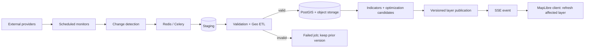

# HEAT//SHIFT

> **Don't Just Map the Heat. Change the City.**
> แพลตฟอร์มข่าวกรองเชิงพื้นที่เพื่อการตัดสินใจลงทุนลดความร้อนในกรุงเทพฯ

HEAT//SHIFT เป็นระบบ map-first ที่แยกวันที่ผู้ให้บริการสังเกตข้อมูลออกจากวันที่ระบบตรวจสอบล่าสุดอย่างชัดเจน ระบบประกอบด้วย Next.js, FastAPI, PostgreSQL/PostGIS, Redis/Celery และ object storage สำหรับ raster ขนาดใหญ่ พร้อม workflow แบบ `STAGING → VALIDATION → PROCESSING → PUBLISHING → CACHE INVALIDATION → CLIENT NOTIFICATION`

> **ข้อสำคัญ:** fixture ที่มากับ repository มีไว้ทดสอบ pipeline เท่านั้น ทุก record ระบุ `fixture_kind: synthetic` และห้ามนำไปแสดงเป็นการสังเกตจริง การใช้งานข้อมูลจริงต้องตั้ง credential ของ provider และผ่าน validation ก่อน publish

## เริ่มใช้งาน

ต้องมี Docker Engine + Docker Compose v2

```bash
make setup
# แก้ .env และเปลี่ยนค่า CHANGE_ME ทุกค่า
# รหัสใน DATABASE_URL ต้องตรง POSTGRES_PASSWORD และ S3_SECRET_KEY ต้องตรง MINIO_ROOT_PASSWORD
make up
```

เมื่อทุก service พร้อม:

- Web UI: <http://localhost:3000>
- REST API / OpenAPI: <http://localhost:8000/api/docs>
- Health: <http://localhost:8000/api/health>
- MinIO console: <http://localhost:9001>

หลังระบบเริ่มทำงาน Celery Beat จะตรวจ catalog ขอบเขต 50 เขตของ BMA รายสัปดาห์ ขอบเขตทางการต้อง publish ก่อน satellite/WorldPop regional aggregation ใน deployment ใหม่ สามารถสั่งครั้งแรกจาก Data Observatory โดยเลือก “ขอบเขต 50 เขต กทม.”

ตัวตรวจ OpenStreetMap รายสัปดาห์ใช้ replication checkpoint ร่วมกับ snapshot checksum ของ feature ที่เกี่ยวข้องในกรุงเทพฯ ดึงเฉพาะสถานที่สาธารณะที่เข้าข่ายสำรวจผ่าน Overpass แล้วผูกจุดเข้ากับขอบเขตเขตทางการ ตำแหน่งเหล่านี้เริ่มในสถานะ `insufficient_evidence`: แสดงเป็นจุดคัดกรองบนแผนที่ได้ แต่ไม่มีต้นทุน/ผลประโยชน์ที่แต่งขึ้นและจะไม่เข้า optimizer จนกว่าจะผ่านการอนุมัติหลักฐาน

หลังรัน City Optimizer ผู้ใช้สามารถส่งออกรายงาน HTML ที่พิมพ์หรือบันทึกเป็น PDF ได้ รายงานดึงผลจาก optimization run ที่บันทึกใน backend พร้อม dataset versions, หลักฐาน, ความไม่แน่นอน และคำเตือนเมื่อผลลัพธ์ล้าสมัย

Data Observatory มี evidence gate ภาษาไทยสำหรับผู้ดูแล: บันทึก `CostAssumption` แบบ versioned พร้อม URL หลักฐาน และอนุมัติ candidate ได้ต่อเมื่อยืนยันการสำรวจหน้างาน สิทธิใช้พื้นที่ และการทบทวนการออกแบบ/การเข้าถึงครบ ระบบจะกัน candidate ที่ยังไม่มีต้นทุนหรือ feasibility ออกจาก OR-Tools และทำผล optimization เดิมเป็น outdated เมื่อ input ที่อนุมัติเปลี่ยน

ชั้น Landsat LST, Sentinel-2 NDVI และ Dynamic World vegetation/built-up ใช้ XYZ tiles ที่สร้างจาก Earth Engine source asset version เดียวกับข้อมูลซึ่งผ่าน validation แล้ว MapLibre ขอเฉพาะ tile ใน viewport และยังใช้ขอบเขตเขตเป็น click target/fallback หากยังไม่ได้ตั้ง GEE credential ระบบจะแจ้งว่า raster ไม่พร้อมและไม่สร้าง heatmap ปลอม

Vector GeoJSON โหลดตาม viewport จริง: client debounce/ยกเลิก request เก่า, PostGIS กรองด้วย spatial index, response มี ETag/cache version และ SSE refresh เฉพาะ active layer ที่ได้รับผลกระทบ การค้นหาเขตใช้รายการชื่อ/centroid ขนาดเล็กก่อนโหลด boundary ที่เลือก จึงไม่ต้องดาวน์โหลดข้อมูลกรุงเทพฯ ทั้งชุดทุกครั้งที่เลื่อนแผนที่

ตรวจสอบสถานะด้วย `docker compose ps` หรือ `make smoke` และดู worker ด้วย `make logs` หน้า Data Observatory แสดงการตรวจความพร้อมเบื้องต้นจาก runtime, PostGIS, Redis, rate limit, OIDC, CORS และ Earth Engine configuration โดย API ไม่เปิดเผย secret, token, URL หรือ credential path รันซ้ำใน release pipeline ได้ด้วย `make readiness` (exit code 2 หมายถึงยังมี blocker) ผล `configuration_ready` ครอบคลุมเฉพาะการตั้งค่าและ dependency; ต้องทดสอบ provider identity, worker/Beat และ ingestion-to-map จริงก่อนเปิดใช้งาน

เปิด metrics/alert evaluation สำหรับ local operations ด้วย `make observability` (Prometheus ที่พอร์ต 9090) และสร้าง Postgres backup ที่มี checksum ด้วย `make backup`; production ต้องส่ง alert ไปยังระบบ on-call และสำรอง object storage แยกจาก database dump

## โหมดข้อมูล

| โหมด | ค่า | การใช้งาน |
|---|---|---|
| Demo UI | `NEXT_PUBLIC_DEMO_MODE=true` | แสดง local fixture พร้อมป้าย “ข้อมูลสาธิต” ชัดเจน เมื่อ API จริงยังไม่มีข้อมูลที่ publish แล้ว |
| Real providers | provider credentials + `NEXT_PUBLIC_DEMO_MODE=false` | ใช้เฉพาะ dataset version ที่ผ่าน validation และถูก publish |
| Fixture ingestion | `ALLOW_FIXTURE_INGESTION=true` | เปิดเฉพาะการทดสอบ local/CI; endpoint ยังต้องใช้ `X-Admin-Key` |

ตัวอย่างทดสอบ publish event โดยไม่ปลอมว่าเป็นข้อมูลจริง:

```bash
# ตั้ง ALLOW_FIXTURE_INGESTION=true ใน .env แล้ว restart api/worker ก่อน
docker compose up -d --force-recreate api worker

# terminal 1: ติดตาม SSE
curl -N http://localhost:8000/api/events/stream

# terminal 2: fixture ingestion ที่มีสิทธิ์
ALLOW_FIXTURE_INGESTION=true \
ADMIN_API_KEY='<same-value-as-.env>' \
python3 scripts/simulate_provider_update.py
```

## โครงสร้างระบบ

```text
apps/web/       Next.js App Router, MapLibre/deck.gl, Thai UX
apps/api/       FastAPI, domain services, Celery, SQLAlchemy, tests
infra/          container images, PostGIS and MinIO bootstrap
data/fixtures/  synthetic integration fixtures only
docs/           architecture, providers, science, operations
scripts/        smoke and simulated-update runners
```



## คำสั่งพัฒนา

```bash
make test          # API + frontend tests
make test-api      # pytest in API container
make test-web      # frontend test script
make lint
make readiness     # ต้องเปิด stack ก่อน; ตรวจ config และ live dependencies โดยไม่อ่านค่า secret ออกมา
make migrate
make seed          # development seed; must remain visibly labelled demo
make down
```

หากรันโดยไม่ใช้ Docker ให้ดูคำสั่งและ version ใน `apps/api/pyproject.toml` กับ `apps/web/package.json` โดยตรง

GitHub Actions ทดสอบ PostGIS + Redis + Celery จริงแยกจาก unit tests โดยตรวจงานตั้งแต่ enqueue ถึง versioned map API และ SSE stream ต่อเนื่อง fixtures ถูกระบุเป็นข้อมูลสังเคราะห์เสมอ ดูขอบเขตหลักฐานและวิธีรันใน [docs/testing.md](docs/testing.md)

## Credential ที่ต้องใช้สำหรับ production ingestion

- Google Earth Engine project + service account ที่มีสิทธิ์อ่าน Landsat, Sentinel-2 และ Dynamic World
- WorldPop/HTTP configuration ตามเงื่อนไขการเผยแพร่ของ version ที่เลือก
- OpenStreetMap Overpass ใช้ได้กับ Bangkok pilot; production ปริมาณสูงควรใช้ provider-approved extract/incremental feed และตั้ง rate limit อย่างรับผิดชอบ
- Overture release URL/version (หากเปิด connector)
- S3-compatible object storage สำหรับ raster/derived tiles
- `ADMIN_API_KEY` ใช้ได้เฉพาะ local/pilot; ต้องเปลี่ยนเป็น OIDC/SSO + RBAC ขององค์กรก่อนเปิดสู่ภายนอก
- Production admin API บังคับ `ADMIN_AUTH_MODE=oidc` และตรวจ JWT signature/issuer/audience/expiry/role จาก JWKS; local shared key ถูกปฏิเสธแม้เปลี่ยนเป็นค่าที่คาดเดายาก

Open-Meteo ไม่ควรถูกอธิบายว่าเป็นข้อมูลดาวเทียม และ WorldPop ต้องแสดง reference year เสมอ ดูรายละเอียดที่ [docs/data-sources.md](docs/data-sources.md)

WorldPop Global2 ใช้งานแบบ anonymous ได้ภายใต้ quota ของผู้ให้บริการ หรือกำหนด `WORLDPOP_API_KEY` สำหรับโควตาที่ได้รับอนุมัติ ระบบเลือกปีล่าสุดที่ไม่ใช่อนาคตโดยอัตโนมัติและไม่เรียก population estimate ว่า real-time

## ข้อจำกัดที่ต้องสื่อสารกับผู้ใช้

- Landsat/Sentinel มีความล่าช้าและเมฆบัง จึงไม่ใช่อุณหภูมิ real-time
- Land Surface Temperature ไม่เท่ากับอุณหภูมิอากาศระดับคนเดินถนน
- Heat Exposure Priority ไม่ใช่ดัชนีความยากจนหรือความเหลื่อมล้ำ หากไม่มีข้อมูล socioeconomic ที่ตรวจสอบแล้ว
- ค่า cooling effect และ intervention cost ต้องมาจากสมมติฐานที่อ้างอิง/อนุมัติ ห้าม backend สร้างค่าขึ้นเอง
- ผลอนาคตระยะ 1/3/5 ปีควรเรียก “scenario” จนกว่าจะผ่าน temporal และ spatial holdout validation

อ่าน [docs/scientific-methodology.md](docs/scientific-methodology.md) ก่อนใช้ผลเพื่อการจัดซื้อหรือนโยบาย

## เอกสาร

- [สถาปัตยกรรมและ data lifecycle](docs/architecture.md)
- [Data sources, freshness และ credentials](docs/data-sources.md)
- [วิธีคำนวณและข้อจำกัดทางวิทยาศาสตร์](docs/scientific-methodology.md)
- [Runbook การปฏิบัติการและเหตุขัดข้อง](docs/operations-runbook.md)
- [Security และ production checklist](docs/security.md)

## License / attribution

Source code ยังไม่ได้กำหนด license สำหรับการแจกจ่ายต่อ Dataset แต่ละแหล่งยังอยู่ภายใต้ license/terms ของเจ้าของข้อมูล Basemap ต้องคง attribution ที่ style/ผู้ให้บริการกำหนด และห้ามนำ credential หรือไฟล์ดาวน์โหลดที่ห้ามเผยแพร่เข้า Git
