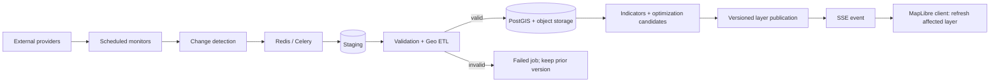

# HEAT//SHIFT

> **Don't Just Map the Heat. Change the City.**
> แพลตฟอร์มข่าวกรองเชิงพื้นที่เพื่อการตัดสินใจลงทุนลดความร้อนในกรุงเทพฯ

HEAT//SHIFT เป็นระบบ map-first ที่แยกวันที่ผู้ให้บริการสังเกตข้อมูลออกจากวันที่ระบบตรวจสอบล่าสุดอย่างชัดเจน ระบบประกอบด้วย Next.js, FastAPI, PostgreSQL/PostGIS, Redis/Celery และ object storage สำหรับ raster ขนาดใหญ่ พร้อม workflow แบบ `STAGING → VALIDATION → PROCESSING → PUBLISHING → CACHE INVALIDATION → CLIENT NOTIFICATION`

> **ข้อสำคัญ:** fixture ที่มากับ repository มีไว้ทดสอบ pipeline เท่านั้น ทุก record ระบุ `fixture_kind: synthetic` และห้ามนำไปแสดงเป็นการสังเกตจริง การใช้งานข้อมูลจริงต้องตั้ง credential ของ provider และผ่าน validation ก่อน publish

## เริ่มใช้งาน

ต้องมี Docker Engine + Docker Compose v2

```bash
make setup
# แก้ .env และเปลี่ยนค่า CHANGE_ME ทุกค่า
# รหัสใน DATABASE_URL ต้องตรง POSTGRES_PASSWORD และ S3_SECRET_KEY ต้องตรง MINIO_ROOT_PASSWORD
make up
```

เมื่อทุก service พร้อม:

- Web UI: <http://localhost:3000>
- REST API / OpenAPI: <http://localhost:8000/api/docs>
- Health: <http://localhost:8000/api/health>
- MinIO console: <http://localhost:9001>

ตรวจสอบสถานะด้วย `docker compose ps` หรือ `make smoke` และดู worker ด้วย `make logs`

## โหมดข้อมูล

| โหมด | ค่า | การใช้งาน |
|---|---|---|
| Demo UI | `NEXT_PUBLIC_DEMO_MODE=true` | แสดง local fixture พร้อมป้าย “ข้อมูลสาธิต” ชัดเจน เมื่อ API จริงยังไม่มีข้อมูลที่ publish แล้ว |
| Real providers | provider credentials + `NEXT_PUBLIC_DEMO_MODE=false` | ใช้เฉพาะ dataset version ที่ผ่าน validation และถูก publish |
| Fixture ingestion | `ALLOW_FIXTURE_INGESTION=true` | เปิดเฉพาะการทดสอบ local/CI; endpoint ยังต้องใช้ `X-Admin-Key` |

ตัวอย่างทดสอบ publish event โดยไม่ปลอมว่าเป็นข้อมูลจริง:

```bash
# ตั้ง ALLOW_FIXTURE_INGESTION=true ใน .env แล้ว restart api/worker ก่อน
docker compose up -d --force-recreate api worker

# terminal 1: ติดตาม SSE
curl -N http://localhost:8000/api/events/stream

# terminal 2: fixture ingestion ที่มีสิทธิ์
ALLOW_FIXTURE_INGESTION=true \
ADMIN_API_KEY='<same-value-as-.env>' \
python3 scripts/simulate_provider_update.py
```

## โครงสร้างระบบ

```text
apps/web/       Next.js App Router, MapLibre/deck.gl, Thai UX
apps/api/       FastAPI, domain services, Celery, SQLAlchemy, tests
infra/          container images, PostGIS and MinIO bootstrap
data/fixtures/  synthetic integration fixtures only
docs/           architecture, providers, science, operations
scripts/        smoke and simulated-update runners
```



## คำสั่งพัฒนา

```bash
make test          # API + frontend tests
make test-api      # pytest in API container
make test-web      # frontend test script
make lint
make migrate
make seed          # development seed; must remain visibly labelled demo
make down
```

หากรันโดยไม่ใช้ Docker ให้ดูคำสั่งและ version ใน `apps/api/pyproject.toml` กับ `apps/web/package.json` โดยตรง

## Credential ที่ต้องใช้สำหรับ production ingestion

- Google Earth Engine project + service account ที่มีสิทธิ์อ่าน Landsat, Sentinel-2 และ Dynamic World
- WorldPop/HTTP configuration ตามเงื่อนไขการเผยแพร่ของ version ที่เลือก
- OpenStreetMap Overpass หรือ provider-approved incremental feed; ตั้ง rate limit อย่างรับผิดชอบ
- Overture release URL/version (หากเปิด connector)
- S3-compatible object storage สำหรับ raster/derived tiles
- `ADMIN_API_KEY` หรือเปลี่ยนเป็นระบบ identity/role ขององค์กรก่อนเปิดสู่ภายนอก

Open-Meteo ไม่ควรถูกอธิบายว่าเป็นข้อมูลดาวเทียม และ WorldPop ต้องแสดง reference year เสมอ ดูรายละเอียดที่ [docs/data-sources.md](docs/data-sources.md)

## ข้อจำกัดที่ต้องสื่อสารกับผู้ใช้

- Landsat/Sentinel มีความล่าช้าและเมฆบัง จึงไม่ใช่อุณหภูมิ real-time
- Land Surface Temperature ไม่เท่ากับอุณหภูมิอากาศระดับคนเดินถนน
- Heat Exposure Priority ไม่ใช่ดัชนีความยากจนหรือความเหลื่อมล้ำ หากไม่มีข้อมูล socioeconomic ที่ตรวจสอบแล้ว
- ค่า cooling effect และ intervention cost ต้องมาจากสมมติฐานที่อ้างอิง/อนุมัติ ห้าม backend สร้างค่าขึ้นเอง
- ผลอนาคตระยะ 1/3/5 ปีควรเรียก “scenario” จนกว่าจะผ่าน temporal และ spatial holdout validation

อ่าน [docs/scientific-methodology.md](docs/scientific-methodology.md) ก่อนใช้ผลเพื่อการจัดซื้อหรือนโยบาย

## เอกสาร

- [สถาปัตยกรรมและ data lifecycle](docs/architecture.md)
- [Data sources, freshness และ credentials](docs/data-sources.md)
- [วิธีคำนวณและข้อจำกัดทางวิทยาศาสตร์](docs/scientific-methodology.md)
- [Runbook การปฏิบัติการและเหตุขัดข้อง](docs/operations-runbook.md)
- [Security และ production checklist](docs/security.md)

## License / attribution

Source code ยังไม่ได้กำหนด license สำหรับการแจกจ่ายต่อ Dataset แต่ละแหล่งยังอยู่ภายใต้ license/terms ของเจ้าของข้อมูล Basemap ต้องคง attribution ที่ style/ผู้ให้บริการกำหนด และห้ามนำ credential หรือไฟล์ดาวน์โหลดที่ห้ามเผยแพร่เข้า Git
